<div align="center">

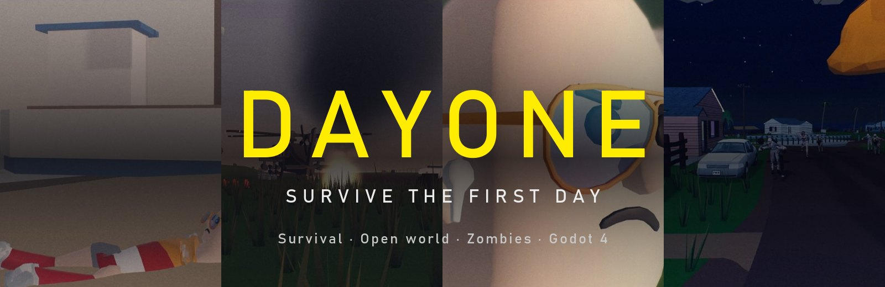

<br>


-lightgrey)


**Jogo de sobrevivência em mundo aberto numa ilha litorânea tomada por infectados.**<br>
Um autor · motor Godot 4 · feito para rodar liso em PC fraco.

[🎬 Trailer](#-o-trailer) · [🎮 Jogo](#-o-jogo) · [🛠 Engenharia](#-engenharia-os-problemas-dif%C3%ADceis) · [📊 Números](#-em-n%C3%BAmeros) · [▶ Rodar](#-como-rodar)

</div>

> **TL;DR (EN)** — DAYONE is a single-author, open-world zombie survival game built (with AI coding agents as pair-programmers) in **Godot 4.7** (GDScript, Compatibility renderer) and engineered to hit **60 FPS on a GT 730-class GPU**. ~53k lines of GDScript, a 208-script automated test suite that drives the *real* game through *real* input events, a data-driven item/loot pipeline, a Blender/Python asset toolchain, and a cinematic trailer rendered from the game engine itself. This page documents the interesting engineering problems and how they were solved and measured.

---

## 🎬 O trailer

Dois minutos em 1080p, **renderizados dentro do próprio jogo** (Godot Movie Maker) com pós-processamento de cinema feito em CPU e áudio sintetizado. O mesmo vídeo vira a cutscene de abertura do jogo — enquanto ele toca, os shaders e recursos da partida já estão sendo aquecidos por baixo, então o menu abre sem travar.

<table>
<tr>
<td width="50%">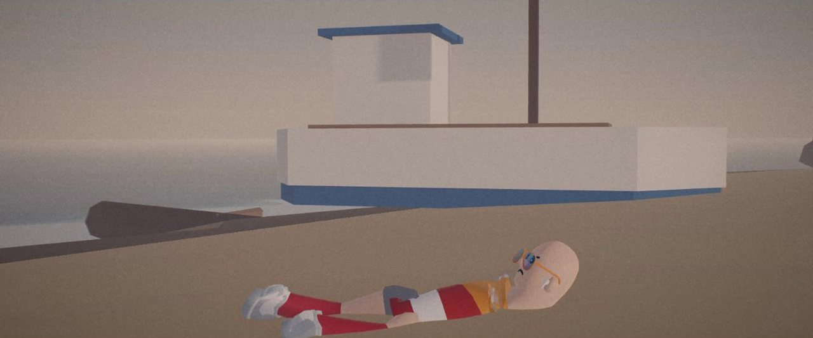</td>
<td width="50%">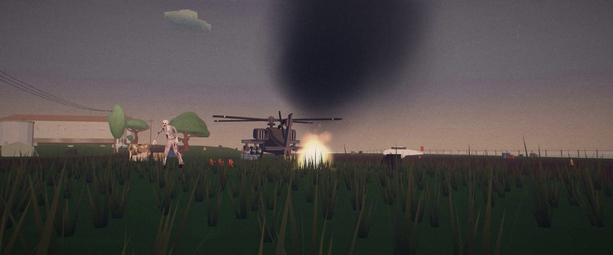</td>
</tr>
<tr>
<td>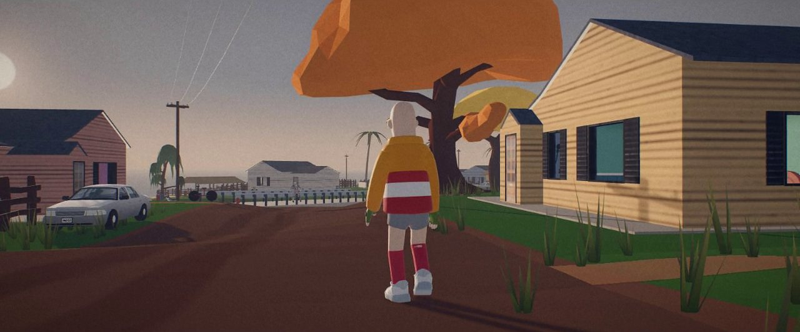</td>
<td>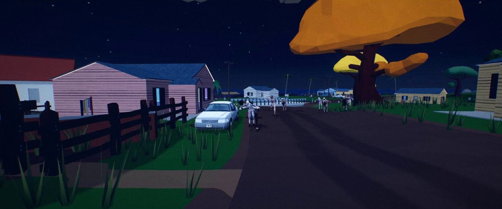</td>
</tr>
</table>

> O arquivo completo (`catcine/DAYONE_trailer.mp4`, Git LFS) está no repositório.

---

## 🎮 O jogo

Você é **o Pescador**: cai do barco numa tempestade e acorda de bruços numa praia da **Ilha do Tauá**, no *Dia 1* de uma pandemia (COROV-27) que infectou 90% da humanidade. Coletar, construir, lutar e dirigir — sem HUD pesada, sem tutorial na cara.

<table>
<tr>
<td width="50%">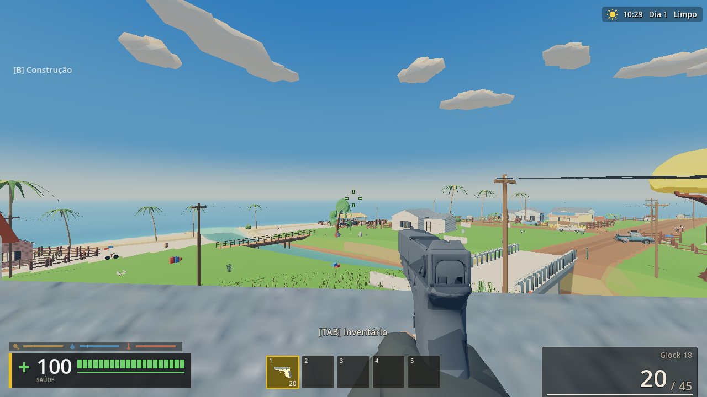<br><sub>Ilha litorânea: vila, ponte, praia, estrada de terra</sub></td>
<td width="50%">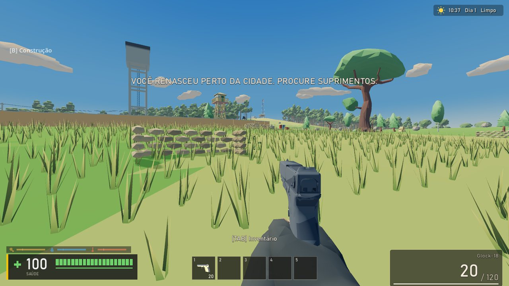<br><sub>Campo aberto, torre de vigia e mata ao fundo</sub></td>
</tr>
<tr>
<td>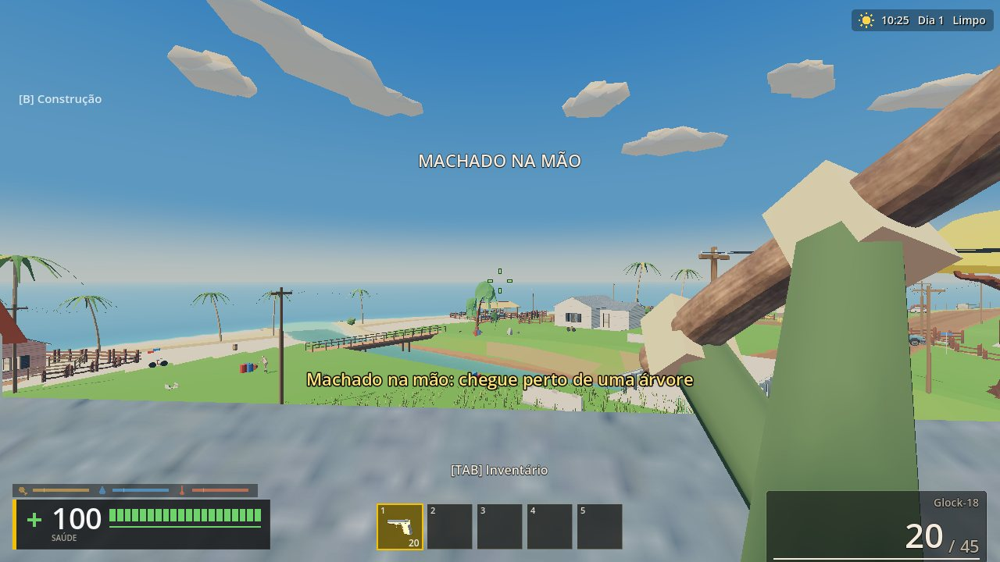<br><sub>Ferramentas na mão: machado derruba árvore (6 golpes)</sub></td>
<td>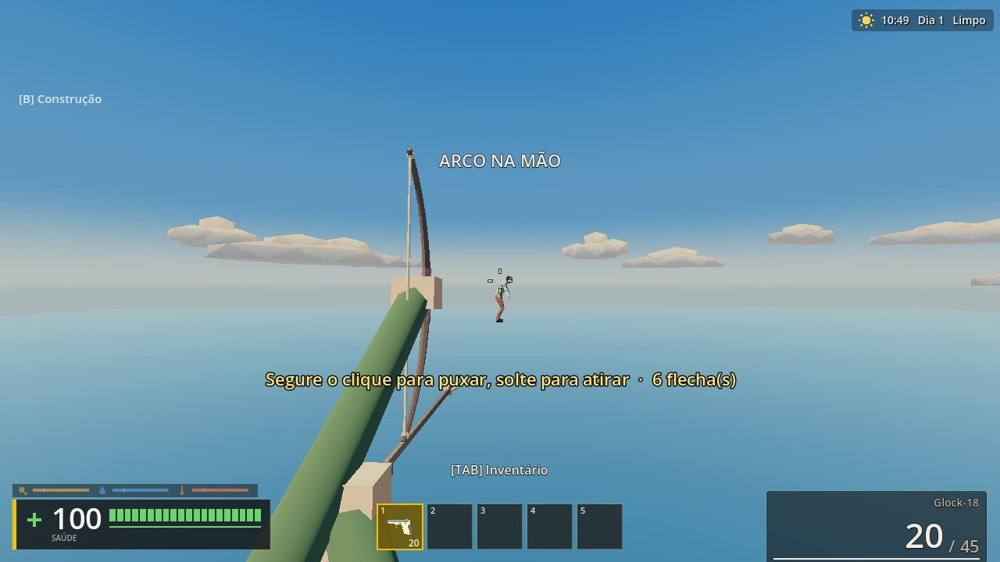<br><sub>Arco com balística real: puxa, solta, a flecha cai</sub></td>
</tr>
<tr>
<td>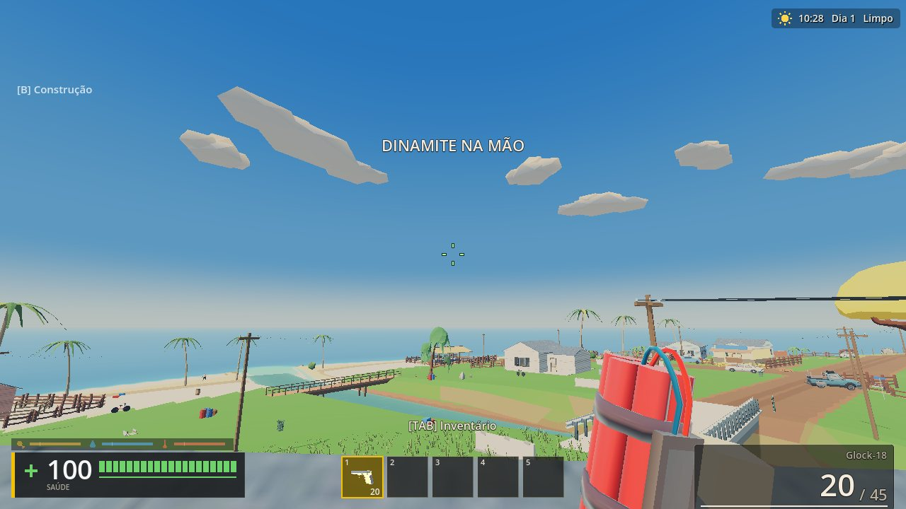<br><sub>Arremessáveis: dinamite, mina naval, distrações sonoras</sub></td>
<td>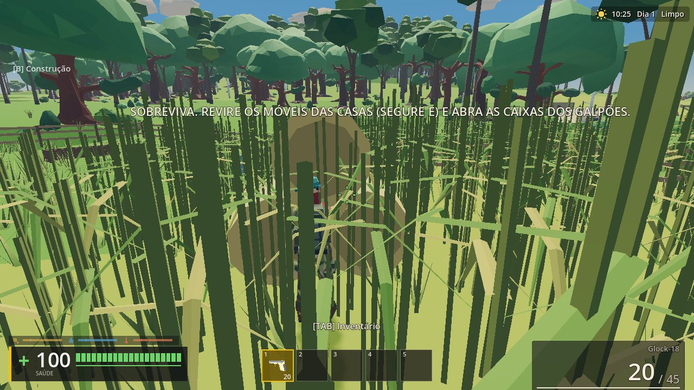<br><sub>Vegetação densa, esconderijo e ruído de passos</sub></td>
</tr>
</table>

### O que já funciona

| Sistema | Resumo |
|---|---|
| 🧟 **Zumbis** | IA com sentidos (vê a 35 m, ouve passos ≤10 m e tiros até 150 m), variações por instância, separação de horda, morte com desmembramento físico, diretor que mantém ~20 vivos por cidade com teto global (orçamento por quadro). |
| 🔫 **Armas** | AK, M4, Mosin, M107, M249, Uzi e pistolas. ADS real, miras holográfica/ACOG/luneta, balística, coice, dano por zona (cabeça ≈50%, corpo ≈20%), som em camadas. |
| 🏹 **Corpo a corpo e arremesso** | Machado, picareta, martelo, faca, arco e flecha, dinamite, mina, granada, lanterna (celular). |
| 🪓 **Coleta e craft** | Árvores tombam e viram toras; pedras mineráveis; construção de base consome madeira; fogueira cozinha e aquece. |
| 🦌 **Fauna** | Cervo, cachorro, lobo e galinha com esqueleto próprio, IA de fuga/caça; caça rende carne, pele, gordura e osso. |
| 🍖 **Sobrevivência** | Fome, sede, temperatura, água suja/salgada, doença (carne crua) e antibiótico. |
| 🎒 **Inventário** | Grade estilo DayZ com mochila, proximidade, peso, baús e saque em móveis. |
| 🚗 **Veículos** | Física `VehicleBody3D` com marchas/RPM, dano por batida, combustível e kit de reparo. |
| 🌦 **Mundo** | Ciclo dia/noite, clima, 3 cidades, quartel, usina, represa, pista, farol. |
| ⛵ **Objetivo final** | Consertar o barco **MARÉ MANSA** (galão, bateria, kit, corda, toras) e fugir da ilha. |

### O mapa

Ilha de **1,2 × 1,2 km** com pontos de interesse autorais (desenhados em JSON, não procedurais) e três níveis de loot.

<div align="center">
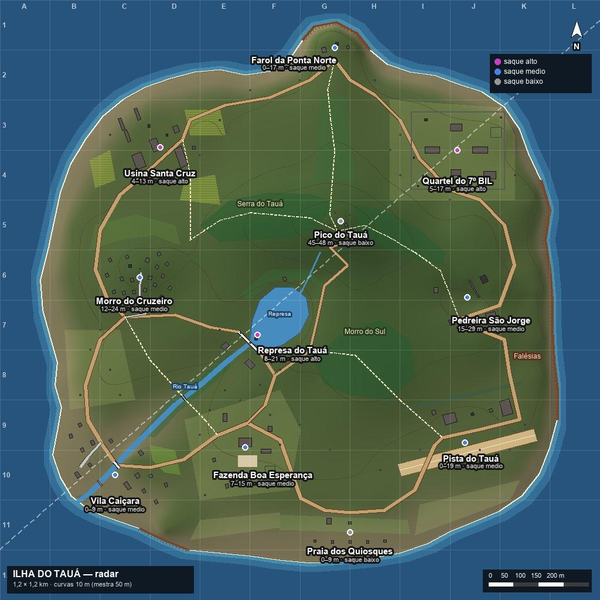
</div>

### Itens

Mais de 50 itens low poly gerados por script no Blender, com ícones de inventário renderizados a partir dos próprios modelos.

<div align="center">
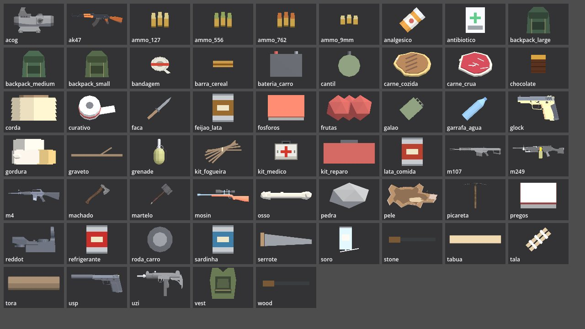
</div>

---

## 📊 Em números

| | |
|---|---|
| **53 mil linhas** de GDScript | 307 scripts (`core/`, `ui/`, `maps/`, `autoload/`, `cinematic/`) |
| **208 scripts de teste** (~21 mil linhas) | ≈ 40% do código é teste — rodam o jogo real |
| **80 ferramentas** Python/Blender/GDScript | bake do mapa, geração de itens, animais, trailer, áudio |
| **1,2 × 1,2 km** de mapa | autoral, com terreno em *heightmap* assado por script |
| **3.371 props** auditados de colisão | 251 assets-fonte; 207 já testados contra a malha real |
| **64 Hz** de física | 1280×720, renderer *Compatibility* (OpenGL), meta 60 FPS em GT 730 |
| **2 min** de trailer 1080p | renderizado pelo próprio motor do jogo |

---

## 🛠 Engenharia: os problemas difíceis

### Arquitetura em uma imagem

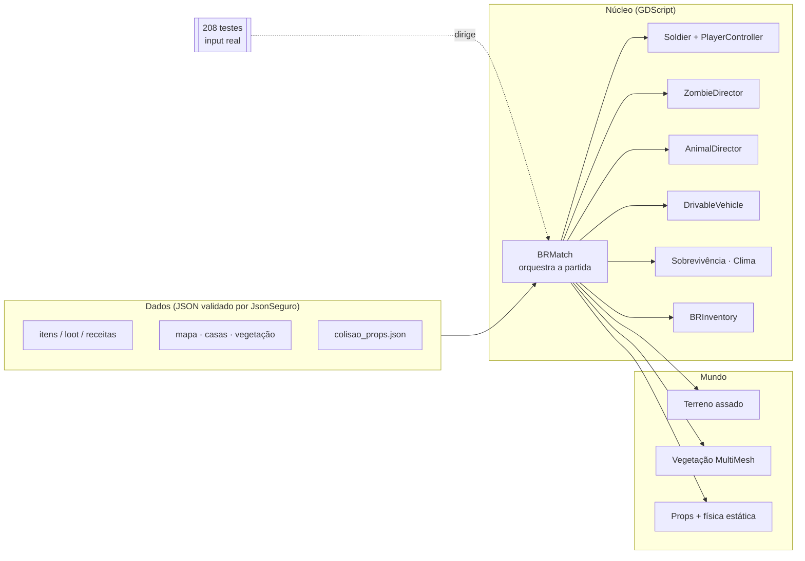

### 1. Colisão pela **forma real** do objeto — e não pela caixa

**Problema.** Jogador atravessava árvores inclinadas, cabines de carro, rochas — e a câmera em 3ª pessoa entrava na geometria. A colisão estava feita por AABB (caixa) e por cilindros, que mentem sobre a forma.

**Solução.**
- Um teste novo trata a **malha visual como verdade**: lança raios na superfície de cada instância do mundo, agrupa por *asset-fonte* (props se repetem, então corrige-se na origem e todas as instâncias herdam) e põe o `Soldier` real para **correr contra cada asset**. "Atravessou" = o eixo da cápsula cruzou uma face da malha (`TriangleMesh.intersect_segment`).
- Correção na fonte: `IlhaVegetation.casco_tronco()` (casco convexo da malha entre 0 e 3,4 m), `DrivableVehicle._casco_carroceria()` (carroceria fiel sem mexer na suspensão) e um **catálogo por asset** `colisao_props.json` (`trimesh | convexo | caixa | nenhuma`) que muda *todas* as instâncias de um tipo de uma vez.
- Câmera 3ª pessoa varrida por esfera, em vez de testar só o ponto-alvo:

```gdscript
var esf := SphereShape3D.new(); esf.radius = 0.25
var qs := PhysicsShapeQueryParameters3D.new()
qs.shape = esf
qs.transform = Transform3D(Basis(), focus)
qs.motion = cam_pos - focus                 # varre foco → câmera
qs.collision_mask = Soldier.LAYER_WORLD
var mov := soldier.get_world_3d().direct_space_state.cast_motion(qs)
if mov.size() == 2 and float(mov[0]) < 1.0:
    cam_pos = focus + (cam_pos - focus) * float(mov[0])
```

**Resultado (medido).** Dos 207 assets testados, só árvores e carros atravessavam. Depois da correção: carvalho, coqueiro, pedras, barracas, barreiras, sacos, caixas e sedan com **0 atravessamentos**, câmera incluída; `andar_mundo` com **0 / 25.322** quadros dentro de sólido. Assets macios por design (capim, arbustos) continuam atravessáveis de propósito.

### 2. Desempenho em hardware fraco (GT 730 / i7-3770)

O alvo é **60 FPS a 1024×768**, então cada decisão é de orçamento:

- **Renderer Compatibility** (OpenGL) e visual low poly, pensado para pouca GPU.
- **Vegetação em `MultiMesh`**: milhares de árvores/capim em poucas draw calls; a árvore cortada sai do `MultiMesh`, tomba num nó 3D e volta depois (respawn).
- **Props numa única body estática** do `PhysicsServer3D`, em vez de milhares de nós `StaticBody3D`.
- **Zumbis e animais com orçamento**: nascem fora da vista, LOD de IA, teto global (20 por cidade, máx. 70 vivos), tudo escalonado por quadro.
- **Aquecimento de shaders** num `SubViewport` escondido, com orçamento por quadro e pré-montagem da partida (`autoload/loading.gd`). Resultado: o menu abre já "quente".
- Testes de FPS dedicados (`tests/br_perf`, `tests/perf_*`): nenhuma feature entra sem medir.

### 3. Cutscene de abertura sem engasgo

O Godot só toca vídeo **Theora (`.ogv`)** e não havia `ffmpeg` no ambiente. Solução: conversão MP4 → OGV via **Blender 4.5 em linha de comando** (`tools/trailer/blender_para_ogv.py`). A cena principal toca o vídeo enquanto `Loading.iniciar_aquecimento()` compila shaders por baixo; **qualquer tecla/clique pula** para o menu, que continua o aquecimento.

### 4. Animação: retarget Mixamo em **espaço global**

Copiar rotações locais entre esqueletos com poses de repouso diferentes faz o corpo "voar". A solução (`cinematic/mx_retarget.gd`) copia o **movimento global** (`k·motion·k⁻¹·corr·rest`) com correção T→A por osso. O mesmo retarget alimenta zumbis, o herói e as cenas do trailer.

### 5. Testes que jogam o jogo de verdade

Em vez de *mocks*, os testes sobem o `BRMatch` e dirigem o `Soldier` com `Input.action_press` — como um jogador. Isso pegou bugs que testes sintéticos não pegavam (troca de armas, ADS, spawn). Cada teste imprime um veredito (`..._OK`) e salva capturas PNG/JSON para revisão visual.

```
tests/troca_armas        tests/inventario_real     tests/zumbi_dano
tests/corte_arvore       tests/fogueira_real       tests/animais_real
tests/colisao_atravessa  tests/combustivel_barco   tests/zumbi_horda_separacao
```

### 6. Pipeline de assets e conteúdo por dados

- **Itens por JSON** (`game/data/itens/*.json`), modelos gerados por `tools/blender/gerar_itens.py`, ícones renderizados dos próprios `.glb`.
- **Terreno e mapa autorais**: layout em JSON + `bake_ilha.py` (heightmap, estradas, rio, máscaras de mata).
- **Validação de dados em tempo de carga** (`JsonSeguro`): JSON malformado vira aviso, não crash.
- **Trailer como código**: o roteiro é um script Godot (`cinematic/trailer.gd`) com câmera, atores e pós de cinema (grade, bloom, vinheta, grão, DoF por profundidade estimada por IA) rodando em CPU; áudio sintetizado em Python.

---

## 🧭 Roadmap

- [x] Combate, zumbis, inventário, construção, carros, clima
- [x] Machado, picareta, árvores que tombam, mineração, fogueira
- [x] Fauna viva (IA) e caça: carne, pele, gordura
- [x] Fome, sede, temperatura, doença
- [x] Colisão por forma real (auditoria automatizada)
- [ ] Receitas de craft em JSON + tela de craft integrada ao inventário
- [ ] Mochila de couro (pele + corda), roupas com isolamento térmico
- [ ] Pesca, plantio, salvar progresso
- [ ] Lore em jogo: diários, bilhetes e gravações de rádio no loot
- [ ] Playtester automático que sobrevive vários dias usando só input real

Detalhes em [`battle_royale/docs/HANDOFF_PROXIMOS_PASSOS.md`](battle_royale/docs/HANDOFF_PROXIMOS_PASSOS.md).

---

## ▶ Como rodar

**Instalador (Windows):** gere o `DAYONE_Setup.exe` com o script em [`battle_royale/tools/instalador/dayone.iss`](battle_royale/tools/instalador/dayone.iss) (Inno Setup 6) a partir do export do Godot.

**A partir do código-fonte:**

```bash
# 1. Godot 4.7.1
winget install GodotEngine.GodotEngine

# 2. Git LFS (assets pesados)
git lfs install && git clone https://github.com/SRNOFACEXXXX/DAYONE-Survival-Godot.git
cd DAYONE-Survival-Godot && git lfs pull

# 3. Abra battle_royale/game/project.godot no Godot (F5)
#    ou no Windows: "JOGAR DAYONE.cmd"
```

Ao abrir, toca a cutscene; **qualquer tecla pula** para o menu.

---

## 🗂 Estrutura

| Pasta | O que tem |
|---|---|
| `battle_royale/game/` | Projeto Godot: `core/` (gameplay), `ui/`, `maps/`, `autoload/`, `cinematic/`, `tests/` |
| `battle_royale/docs/` | Design, backlog, handoff, lore, QA, estudos |
| `battle_royale/tools/` | Ferramentas de bake, geração de assets, trailer, áudio e instalador |
| `battle_royale/Assets/` | Fontes de assets (modelos, animações, sons, referências) |
| `catcine/` | Trailer em MP4 (Git LFS) |
| `docs/img/` | Imagens deste README |
| `legado/` | Protótipos antigos |

## 📚 Documentação para quem for continuar

[`AGENTS.md`](AGENTS.md) · [Handoff e roadmap](battle_royale/docs/HANDOFF_PROXIMOS_PASSOS.md) · [Lore](battle_royale/docs/LORE.md) · [Acertos e erros](battle_royale/docs/ACERTOS_E_ERROS.md) · [Economia de tokens](battle_royale/docs/ECONOMIA_DE_TOKENS.md) · [Backlog vivo](battle_royale/docs/ATUALIZACAO_DAYONE.md)

## 🤖 Como foi feito

O jogo foi desenvolvido com **agentes de IA (Claude Code) como pair-programmers**; a direção do projeto, as decisões de design, os assets escolhidos e a validação no jogo são do autor. O processo (fluxo de trabalho, economia de tokens, acertos e erros) está documentado em [`ECONOMIA_DE_TOKENS.md`](battle_royale/docs/ECONOMIA_DE_TOKENS.md) e [`ACERTOS_E_ERROS.md`](battle_royale/docs/ACERTOS_E_ERROS.md).

## 📄 Licenças e créditos

O código e o conteúdo autoral são do autor do projeto. Assets de terceiros (Fab, Mixamo, OpenGameArt, bibliotecas de som) mantêm as licenças originais — veja [`ASSET_CREDITS.md`](battle_royale/docs/ASSET_CREDITS.md). Este repositório é um **portfólio técnico**: antes de redistribuir qualquer asset de terceiros, confira a licença do pacote de origem.

<div align="center"><sub>Feito por <a href="https://github.com/SRNOFACEXXXX">@SRNOFACEXXXX</a> · Godot 4 · GDScript · Blender · Python</sub></div>
